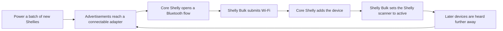

# Shelly Bulk

Shelly Bulk (`shelly_bulk`) is a [HACS](https://hacs.xyz/) custom integration for installers who commission a lot of factory-new Shelly devices into [Home Assistant](https://www.home-assistant.io/). It sits **beside** the built-in Shelly integration. It does not replace it, and it does not speak a private provisioning protocol when Home Assistant already can.

You enter every site value yourself, after install, on the Home Assistant instance that will own the devices: Wi-Fi name and password, the device password, timezone, and the list of MAC addresses, names, and rooms. None of that is shipped in this repository.

## What it does, and why

A new building full of Shelly Plus, Pro, Gen3, and Gen4 devices is awkward to add one Discovered card at a time. Each device will join Wi-Fi over Bluetooth, but only for a short window after it is powered, and only from a Bluetooth adapter that can actually connect.

Shelly Bulk watches the Bluetooth discovery flows that Home Assistant's own Shelly integration already creates (Home Assistant 2025.12 or newer). While provisioning mode is on, it answers those flows with the Wi-Fi credentials stored on its config entry, waits until the core integration has added the device, then turns that Shelly's Bluetooth scanner on. The next box, further down the bench or the corridor, can be heard by a device that was itself only just adopted. Coverage spreads with the install instead of depending on one dongle at the door.



The arrow back to "heard" is advertisement range, not a promise that a Shelly can finish setup for the next device on its own. Shelly's Bluetooth proxy forwards advertisements. It cannot open a GATT connection. The Wi-Fi step still needs a connectable radio in range of the device being adopted: the Home Assistant host adapter, or an ESPHome Bluetooth proxy in active mode. Shellies you have already adopted make those advertisements travel further, so a connectable proxy at the bench can see devices that would otherwise be out of earshot. If the only radio that hears a device is a Shelly scanner, core Shelly aborts that flow with "cannot connect" and Shelly Bulk records it.

## Supported devices

| In scope | Out of scope |
| --- | --- |
| Shelly Gen2 (Plus and Pro), Gen3, and Gen4 in Wi-Fi mode, with Bluetooth RPC still open | Gen1. There is no Bluetooth setup. Add those in core Shelly over the access point or by IP. |
| Dimmers that use the Light, RGB, RGBW, or CCT components, including Dimmer Gen3, Pro Dimmer, Plus Wall Dimmer, and RGBW where the RPC matches | Shelly BLU sensors (BTHome), Wave (Z-Wave), and Gen4 running in Zigbee mode |
| Pro models with Ethernet, after they are on the LAN: Shelly Bulk can still apply a profile over IP | Battery devices are in scope but the setup window is about 3 minutes, and you may have to wake them |

Profiles are sent with Gen2+ RPC (`Sys.SetConfig`, `WiFi.SetConfig`, `Cloud.SetConfig`, `BLE.SetConfig`, `Input.SetConfig`, `Switch.SetConfig`, `Light.SetConfig`, and the same shape for `RGB`, `RGBW`, and `CCT`, plus `Shelly.SetAuth`, `Shelly.CheckForUpdate`, and `Shelly.Update`). If a model rejects a field, that field is skipped and the rest of the profile still applies. The report says what was skipped.

## Requirements

- Home Assistant **2025.12 or newer**. Bluetooth Wi-Fi provisioning for Shelly landed in 2025.12. This integration was checked against the core Shelly flow on the November 2026 `dev` branch: the Bluetooth confirm step takes an empty form, Wi-Fi SSID and password are one step, and core then turns the access point and Bluetooth RPC off itself.
- The core **Shelly** integration and the **Bluetooth** integration. Shelly Bulk does not vendor its own copy of `aioshelly`; it uses the copy Home Assistant already installed for Shelly.
- A connectable Bluetooth adapter on the Home Assistant host, or one or more [ESPHome Bluetooth proxies](https://esphome.io/components/bluetooth_proxy/) set to **active**, with a few free connection slots. Two proxies with about four slots each is a comfortable bench. More than about five connections on one radio gets unreliable, so Shelly Bulk's concurrency defaults to 2 and will not go above 5.
- An IoT SSID that is **2.4 GHz** and not WPA3-only. 5 GHz-only, band steering, captive portals, and client isolation break the join.
- DHCP space for the whole batch.
- mDNS (or a reflector) between the IoT VLAN and Home Assistant. After Wi-Fi provisioning, core Shelly waits for the device to announce itself. Without mDNS the flow falls back to an active lookup and often times out.
- Admin access to Home Assistant. Shelly Bulk writes the core Shelly config entry (scanner mode, and the device password after `Shelly.SetAuth`).

## Install with HACS

1. In HACS, open **Integrations**, then the menu, then **Custom repositories**.
2. Add `https://github.com/ianda-tech/shelly-hass` as an **Integration**.
3. Download **Shelly Bulk**.
4. Restart Home Assistant.
5. Go to **Settings → Devices & services → Add integration → Shelly Bulk**.

## Install manually

1. Copy the `custom_components/shelly_bulk` folder from this repository into your Home Assistant config directory, so the path is `config/custom_components/shelly_bulk`.
2. Restart Home Assistant.
3. Add the **Shelly Bulk** integration as above.

The folder must contain `manifest.json`. Do not rename the domain.

## First setup

Every value below is typed into **this** Home Assistant. The integration package does not contain an SSID, a password, a timezone, or a device list.

1. Start the config flow. Give the entry a site name. That name is only a label.
2. Enter the Wi-Fi SSID and password the new Shellies should join. They are stored in the config entry. Diagnostics and logs mask them.
3. Optionally enter one device password. Leave it blank if these devices should stay without authentication. Shelly Bulk will not change a device that already has a password.
4. Enter an IANA timezone, the same kind of name Home Assistant shows in its own settings. The field is empty on purpose. The description only tells you which zone this Home Assistant is using, so you can type it if that is the one you want.
5. On the next step, choose the generic behaviour:
   - **Disable Shelly Cloud** and **disable the access point** default to on.
   - **Disable Bluetooth RPC** defaults to on, which matches what core Shelly already did. Turn it off if you still need Bluetooth RPC after setup. The scanner proxy does not need RPC.
   - **Only provision devices in the allowlist** defaults to on. Leave it on. Turning it off adopts every factory-new Shelly any proxy can hear.
   - **Bluetooth scanner mode** defaults to **Active**, which is what you want while commissioning. **Auto** (on recent Home Assistant) uses less airtime later. **Passive** and **Disabled** are there when you are done.
   - Concurrency, retries, and how long provisioning mode stays armed.

You can change all of this later under **Configure** on the integration card: Wi-Fi, security, input profile, output profile, dimmer profile, provisioning, and allowlist import.

### Device list

Put a CSV somewhere under the Home Assistant config directory, for example `config/shelly_bulk/devices.csv`. Then either:

- **Settings → Devices & services → Shelly Bulk → Configure → Import allowlist**, and enter `shelly_bulk/devices.csv`, or
- call the `shelly_bulk.import_allowlist` service with that filename.

The file is read once and stored in Home Assistant's `.storage`. It is not part of this repository, and Shelly Bulk will not follow a path that escapes the config directory. Import again when the list changes.

While "only provision the allowlist" is on, an empty list adopts nothing. The last-error sensor says so.

## Bulk add

Do this at the bench, or in the building with a connectable proxy that can still reach the device you are powering. Work in batches of about **20**. A batch that sits powered for a quarter of an hour locks itself.

### The setup window

Factory-new Gen2, Gen3, and Gen4 firmware (from about 1.7.5, and the tighter 2.x behaviour) accepts unauthenticated Bluetooth RPC only for a while after power-on or a reset:

- about **15 minutes** on mains devices (`provision: pending`)
- about **3 minutes** on battery devices
- about **5 minutes** more after the first IP address (`provision: confirmed`)
- then Bluetooth RPC and the open access point close (`provision: complete`)
- if the window ends before the device gets online, it goes **locked** until you power-cycle it

Shelly Bulk raises a repair and sets the last-error sensor when an allowlisted device is advertising with Bluetooth RPC off. Power-cycle that device. Do not keep retrying a locked unit.

### Walkthrough

1. Confirm the IoT SSID, DHCP, and mDNS **before** you energise a batch. A wrong password burns the window.
2. Put the connectable proxy or the Home Assistant Bluetooth adapter within a few metres of the batch. Metal back boxes and a pile of packed Shellies both hurt range.
3. Import the allowlist if you are using one. Names and rooms in that file are applied after each device joins.
4. Turn on **Provisioning mode** (the switch on the Shelly Bulk device, or the `start_provisioning` service). It turns itself off when the timeout you set is reached. It does not turn itself back on after a restart.
5. Power the batch. Each device that core Shelly discovers, that still has Bluetooth RPC open, and that is on the allowlist (or all of them, if you turned the allowlist requirement off) is answered automatically:
   - confirm the Bluetooth step
   - submit your SSID and password
   - wait while core Shelly provisions Wi-Fi and creates the device
   - set that Shelly's Bluetooth scanner to the mode you chose, so the next devices are heard further away
   - apply cloud, access point, Bluetooth RPC, timezone, name, and any channel profile you enabled
   - if you set a device password, call `Shelly.SetAuth` and write `admin` plus that password into the core Shelly entry so Home Assistant stays connected
   - set the Home Assistant device name and area from the CSV
6. Watch **Devices adopted**, **Devices pending**, **Devices failed**, and **Last error**.
7. Export a report (below). Power-cycle anything that failed because the window closed, then run provisioning again. Devices already added are left alone. Devices that already have authentication are not sent a password and are not modified during adoption.
8. Move the next batch into range, including range of Shellies that are now scanning, and repeat.

Concurrency is how many of those flows run at once. Keep it inside the number of free connectable slots, not the number of Shellies in the building.

Firmware update, if you enabled it, starts `Shelly.Update` with `stage: stable` after the profile. It reboots the device and is the slow part. Leave it off while you are racing a 15-minute window, and turn it on for a later **Apply profile** pass.

## Profiles

Profiles are off until you opt in. Security choices from the config flow (cloud, access point, Bluetooth RPC, timezone, device password, scanner mode) are applied on adoption because you set them there. Input, output, and dimmer sections are applied only when **Apply this profile** is on, or when a CSV row sets the same field for that device.

Open **Configure** and edit one section at a time.

### Security

- **Device password.** `Shelly.SetAuth` with user `admin`, realm set to the device id, and HA1 `SHA-256("admin:<device id>:<password>")`. The password is not logged. If the device already has authentication, Shelly Bulk does not replace it.
- **Cloud.** `Cloud.SetConfig` with `enable: false` when disable-cloud is on. Unchecking it leaves the cloud setting as the device has it.
- **Access point.** Core Shelly turns the AP off after Bluetooth provisioning. Shelly Bulk sends your choice afterwards, so unchecking the box turns the AP back on.
- **Bluetooth RPC.** Same pattern. `BLE.SetConfig` keeps Bluetooth **enabled** (`enable: true`) so the scanner still works, and sets `rpc.enable` from your checkbox.
- **Name and timezone.** `Sys.SetConfig` `device.name` from the allowlist, and `location.tz` from the timezone you entered.
- **Scanner.** Core Shelly option `ble_scanner_mode`, set to active, auto, passive, or disabled.

### Inputs

Per input, Shelly Bulk can set:

| You choose | What is sent |
| --- | --- |
| Switch | `Input.SetConfig` `type: switch` |
| Button | `type: button` |
| Follow | output `in_mode: follow` |
| Toggle / flip | `in_mode: flip` |
| Momentary | `in_mode: momentary` on a switch. On a dimmer, momentary is not valid, so Shelly Bulk sends `dim` and notes that. |
| Detached | `in_mode: detached`. The physical input no longer drives the relay or the light output. |
| Activation | `in_mode: activate` |
| Invert | `Input.SetConfig` `invert: true` or `false` |

`match_input` is a switch power-on state. `toggle` is a dimmer power-on state. A value the component does not accept is skipped for that component.

### Outputs

On each `switch`, `light`, `rgb`, `rgbw`, or `cct` channel:

- `initial_state`: `off`, `on`, `restore_last`, and `match_input` (switches) or `toggle` (dimmers)
- `auto_on`, `auto_on_delay`, `auto_off`, `auto_off_delay`

### Dimmers

On light-like channels, when the dimmer profile is on:

- **Button fade rate** → `button_fade_rate`, 1 (slowest) to 5 (fastest). This is the rate while a button is held.
- **Transition duration** → `transition_duration`, seconds for a 0% to 100% ramp. This is the field the Shelly Light docs actually define.
- **Ramp up / ramp down.** Separate up and down times are **not** in the verified Light config. Shelly Bulk sends them only when that device's current config already has `transition_duration_up` / `transition_duration_down` or `ramp_up` / `ramp_down`. Otherwise it uses `transition_duration` and says so in the report.
- **Minimum and maximum brightness** → `range_map: [min, max]`. Both are required, and max must be greater than min.
- **Night mode** → `night_mode.enable`, `night_mode.brightness`, `night_mode.active_between` as `["HH:MM", "HH:MM"]`.
- **Power-on brightness.** There is no verified `power_on_brightness` field in the public Light config. Shelly Bulk sends `power_on_brightness`, `initial_brightness`, or `brightness` only when `GetConfig` already contains that key. Otherwise it records that the device has nowhere to put it.
- **Button dimming** → `in_mode` `dim` (one button: short press toggles, hold dims) or `dual_dim`.

`apply_profile` runs the same plan against Shellies that are already in Home Assistant. Target a device, an area, a MAC, a model substring, or every Shelly entry.

## Services

Replace the sample MAC and the filename. Call these from **Developer tools → Actions**, an automation, or a script. `site` is only required when you have more than one Shelly Bulk entry.

### Start and stop provisioning

```yaml
action: shelly_bulk.start_provisioning
data:
  provisioning_minutes: 30
```

```yaml
action: shelly_bulk.stop_provisioning
```

The switch and these actions are the same mode. It stays off across restarts.

### Import the allowlist

```yaml
action: shelly_bulk.import_allowlist
data:
  filename: shelly_bulk/devices.csv
  replace: true
```

`filename` is relative to the Home Assistant config directory. `replace: false` merges by MAC.

### Apply the profile

```yaml
action: shelly_bulk.apply_profile
data:
  all_shelly: true
```

```yaml
action: shelly_bulk.apply_profile
data:
  device_id:
    - 0123456789abcdef0123456789abcdef
```

```yaml
action: shelly_bulk.apply_profile
data:
  mac: "00:00:00:00:00:01"
  model_contains: Dimmer
```

### One input

```yaml
action: shelly_bulk.set_input_mode
data:
  mac: "00:00:00:00:00:01"
  input_id: 0
  input_type: button
  input_mode: detached
  invert: false
```

### One dimmer channel

```yaml
action: shelly_bulk.set_dimmer_fade
data:
  mac: "00:00:00:00:00:01"
  channel: 0
  fade_rate: 2
  transition_duration: 1.5
```

`fade_rate` is 1–5. `transition_duration` is seconds.

### Export the report

```yaml
action: shelly_bulk.export_report
data:
  format: both
```

`format` is `csv`, `json`, or `both`. Files land in `config/shelly_bulk/`. They list MAC, name, room, status, model, firmware, host, error, and notes. They do not list the Wi-Fi password, the device password, or the HA1 digest. Allowlist rows that have not been seen yet are included as `not_seen`.

## CSV format

Dummy data only. Do not commit a real list.

```csv
mac,name,room,input,initial_state,fade_rate,transition
00:00:00:00:00:01,Example downlights,Example room,detached,restore_last,,
00:00:00:00:00:02,Example lamp,Example room,dim,restore_last,2,1.5
```

`mac` is required. `name` and `room` (or `area`) become the Home Assistant device name and area; the area is created if it does not exist. `model` / `model_hint` is stored and not sent.

Optional columns, applied to every channel on that row unless you set `channel` to a number:

`input` (shorthand: `switch`, `toggle`, `button`, `momentary`, `detached`, `activation`, `dim`, `dual_dim`), `input_type`, `input_mode`, `invert`, `initial_state`, `auto_on`, `auto_on_delay`, `auto_off`, `auto_off_delay`, `fade_rate`, `transition`, `transition_up`, `transition_down`, `min_brightness`, `max_brightness`, `night_mode`, `night_brightness`, `night_start`, `night_end`, `power_on_brightness`, `button_dimming`.

A second row with the same MAC and `channel` set overrides just that channel. Blank cells do not clear a shared profile; they mean "leave the profile value".

## Sensors and the repair

The Shelly Bulk device (one per config entry) exposes:

- **Devices adopted**
- **Devices pending** (flows running right now)
- **Devices failed**
- **Last error** (`none` when there has not been one)
- **Provisioning mode**

A device that is advertising with Bluetooth RPC off raises **Shelly setup window is closed**. Power-cycle it. The issue is removed if that MAC is later adopted.

## Troubleshooting

| What you see | What it usually means |
| --- | --- |
| Last error says the allowlist is empty | Provisioning is armed and "only the allowlist" is on, but you have not imported a CSV. |
| `flow aborted: ble_not_permitted` or the setup-window repair | The 15-minute (or 3-minute) window has closed, or Bluetooth writes are rejected. Power-cycle the device. |
| `cannot_connect` | Nothing that can open GATT heard the device. A Shelly scanner is not enough on its own. Move a connectable proxy closer. |
| Timed out waiting for Wi-Fi | Wrong SSID or password, 5 GHz or WPA3-only SSID, no DHCP, or mDNS not reaching Home Assistant. |
| `skipped_auth` | The device already has a password, or the advertisement says authentication is on. Shelly Bulk did not send credentials and did not change it. Factory-reset if you meant to adopt it. |
| Adopted, then core Shelly wants a reauth | The device password was set. Reload the Shelly entry; Shelly Bulk writes the password onto that entry after `Shelly.SetAuth`. If the device rebooted mid-write, enter the device password in the Shelly reauth form. |
| Dimmer fade "skipped" | That model has no `button_fade_rate` or `transition_duration`. The note in the report names the field. |
| Power-on brightness not sent | The component config has no brightness field Shelly Bulk is willing to guess. |
| Many identical devices, the wrong one joined | Use the allowlist. Shelly Bulk will not adopt a MAC that is not on it while that option is on. |
| Gen1 never appears | Expected. Gen1 has no Bluetooth RPC. |
| Provisioning mode turned off on its own | The timeout elapsed, or you reloaded the entry (changing options reloads it and stops the loop). |

Core Shelly flow step ids are part of Home Assistant, not this integration. If a future core release renames `bluetooth_confirm` or `wifi_scan`, adoption will record `Unhandled Shelly flow step ...` instead of guessing. Check the release notes and open an issue.

## FAQ

**Does this replace the Shelly integration?**
No. Devices are added by core Shelly. Shelly Bulk only answers the Bluetooth flow, then sets options and RPC on the device core already owns.

**Will adopted Shellies provision the next ones over Bluetooth?**
They help you *hear* the next ones. They do not connect to them. Keep a connectable adapter or ESPHome proxy in the chain.

**Can I adopt a device that already has a password?**
Not automatically. Shelly Bulk will not try the device password against a locked device. Add it yourself in core Shelly, then use **Apply profile** if that Shelly entry already has the right password stored. Apply profile still will not replace an existing device password.

**Where do the secrets live?**
On the Shelly Bulk config entry in Home Assistant's `.storage`, the same way other integrations store passwords. They are masked in diagnostics and in this integration's logs. Do not put them in the CSV. Do not commit a CSV.

**What if I have two sites?**
Add a second Shelly Bulk entry with a different site name. Pass `site:` to services when more than one entry exists.

**Is the workshop script the same thing?**
`tools/shelly_ble_provision.py` is an optional bench tool for a laptop that cannot see the Home Assistant instance. It is not tested on hardware. The integration is the supported path. The script reads secrets from the environment (`SHELLY_WIFI_SSID`, `SHELLY_WIFI_PASS`, `SHELLY_ADMIN_PASS`, `HA_TOKEN`, `SHELLY_TZ`) and has no default timezone.

## Security

- Wi-Fi and device passwords are config-entry data. They are not arguments to the workshop script, not fields in the report, and not written to diagnostics in the clear.
- A log filter masks those values, and the HA1 digest once it has been computed, if they ever appear in a log line or traceback from this integration.
- Devices with authentication already enabled are skipped during adoption. Shelly Bulk does not guess.
- Disabling cloud, the access point, and Bluetooth RPC is available because a commissioned device should not keep an open setup channel. Bluetooth itself stays on when you want the scanner.
- "Only provision the allowlist" defaults to on so a neighbour's new Shelly, or a device already in the building that you did not list, is not adopted just because provisioning mode is on.
- Provisioning mode is a switch with a timeout. It does not survive a restart.
- The allowlist import refuses paths outside the config directory.
- Use a dedicated IoT VLAN. This integration does not configure the network.
- The repository is public. Do not open a pull request that contains a real SSID, password, MAC, or site list.

## Contributing

Issues and pull requests go to [ianda-tech/shelly-hass](https://github.com/ianda-tech/shelly-hass). Code owners are `@ianda-tech`.

```bash
pip install -r requirements_test.txt
pytest
```

GitHub Actions runs hassfest, HACS validation, and pytest. Tests use Home Assistant's config-flow harness and a fake RPC session. They do not talk to hardware. If you change an RPC field, cite the Shelly component doc you checked (`https://shelly-api-docs.shelly.cloud/gen2/`) and say when a model refused it.

Please don't add site defaults "to make the form easier". The config flow is supposed to be empty of SSID, password, timezone, and devices.

## Licence and credits

[MIT](LICENSE). Copyright 2026 Innovate and Automate.

Shelly Bulk is not a Shelly or Home Assistant product. It depends on:

- Home Assistant's Shelly integration, including Bluetooth Wi-Fi provisioning (core 2025.12 and later) and the `ble_scanner_mode` option
- [aioshelly](https://github.com/home-assistant-libs/aioshelly) for RPC over IP, and for the Bluetooth advertisement block layout
- Shelly's Gen2 RPC documentation at [shelly-api-docs.shelly.cloud](https://shelly-api-docs.shelly.cloud/gen2/)

## What is not proven on hardware

The flow step ids, RPC method names, and the fields listed above were checked against public core and Shelly docs. They have **not** been run against a pile of real Shellies. In particular, treat as unverified until you try a device:

- separate dimmer ramp-up and ramp-down fields (not in the public Light config; sent only if the device already has them)
- a dedicated power-on brightness key
- every `in_mode` on every model (cycle, dual_dim, and activate are model-dependent)
- how long a given firmware keeps Bluetooth RPC open after the first IP address
- Shelly scanner "active" as a way to extend GATT range (it does not)

If a call fails on a model, Shelly Bulk keeps going and writes the skipped field into the report. That report is the thing to bring back from the first real batch.
